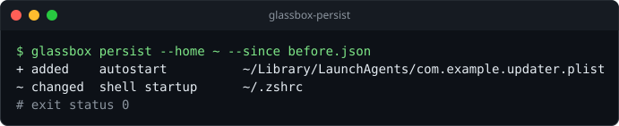

# glassbox

glassbox audits what AI agents and other local processes can access on macOS and Linux.

An agent started from your terminal runs as you. It inherits your files, your credentials and, on
macOS, the privacy grants (such as Full Disk Access) of the app it was launched from. glassbox shows
that reach before you start the agent, and reports how much of each local AI model is already in
memory, and shows what an agent session set up to run again later. It is a single Rust binary with no dependencies.

Status: 0.5.1. Four commands: `reach`, `models`, `persist` and `watch`.

## Example output

`persist` on a demo home directory, compared with a snapshot saved earlier, after a launch agent
was added and a line was appended to `.zshrc`:



## Requirements

- macOS, or Linux on a 64-bit x86-64, ARM64, RISC-V, LoongArch, POWER or s390x machine.
- Rust 1.85 or later to build.
- Nothing else at run time. On macOS the process chain comes from `ps`; on Linux, from `/proc`.

## Install

With Homebrew (macOS on Apple silicon, Linux x86-64 and ARM64):

```
brew install jacob-adm/tap/glassbox
```

Or download the archive for your platform from the
[latest release](https://github.com/jacob-adm/glassbox/releases/latest), check it against
`SHA256SUMS`, and put `glassbox` on your `PATH`. Builds: macOS on Apple silicon, Linux x86-64 and
Linux ARM64 (glibc 2.31 or later).

Or build from a clone of this repository:

```
cargo install --path .
```

## How it works

`glassbox reach` opens each location on a curated list (credentials, shell history, browser
profiles, mail, messages, photos, and the macOS protected folders) read-only, from its own process.
A child process started the same way, such as an agent, inherits the same user, permissions and
privacy grants, so glassbox's reach is the agent's reach.

Files are opened but never read, and nothing is written. A directory is listed only to try opening
up to 32 of its entries; their names are never printed or kept. Each location is reported as
`readable`, `partly-readable` or `listable-only` (a directory in which some or all entries are
refused, as inside a sandbox), `denied-privacy` (EPERM: a privacy control or sandbox),
`denied-permissions` (EACCES: file permissions) or `absent`. The report also shows the process chain
and, on macOS, the app whose privacy grants apply.

`glassbox models` finds local model weight files (Ollama, LM Studio, the Hugging Face cache, or any
directory given with `--dir`) and maps each one read-only to ask the kernel which pages are in the
page cache (`mincore`). No page is read, so measuring does not load the model. A model that is in
the page cache loads from memory; one that is not loads from disk.

`glassbox persist` hashes (SHA-256) every persistence point: launch agents and daemons, systemd
units, autostart entries, cron, shell startup files, SSH and git configuration, git hooks, Python
startup files, and AI agent configurations (Claude Code, Cursor, Codex, Gemini). Save a snapshot
before an agent session and compare after it to see what was added or changed.

`glassbox watch` follows a local agent session transcript (Claude Code by default). When the agent
repeats an identical tool call, produces an unusually long turn, or keeps failing tool calls, it
writes a capture: the trigger, the persistence points added or changed since watching began, the
repository's uncommitted changes, and the agent's process tree with its open network connections. It can pause the agent so you can look
before it continues. Transcripts are read for structure only; their content is never copied.

## Commands

| Command | What it does |
|---|---|
| `glassbox reach` | Report what a process started like this one can read |
| `glassbox reach --json` | The same report as JSON, for scripts and agent tooling |
| `glassbox reach --strict` | Exit 1 if any sensitive location is readable |
| `glassbox reach --audit-json` | One object in the audit result format shared with other audit tools: each location with a rule, severity, message and evidence; exits as `--strict` |
| `glassbox reach --since FILE` | Compare with an earlier `reach --json` report, for example one taken outside a sandbox |
| `glassbox reach --home DIR` | Audit `DIR` instead of `$HOME` |
| `glassbox models` | List local models and how much of each is in the page cache |
| `glassbox models --dir DIR` | Also search `DIR` for `.gguf` and `.safetensors` files |
| `glassbox models --json` | The same list as JSON |
| `glassbox persist` | List persistence points |
| `glassbox persist --save FILE` | Save a snapshot of them |
| `glassbox persist --since FILE --strict` | Report what was added, changed or removed; exit 1 if anything was added or changed |
| `glassbox persist --since FILE --audit-json` | The same comparison as one audit result object; exits as `--strict` |
| `glassbox watch` | Follow the newest local agent session and capture the machine's state on a trigger |
| `glassbox watch --pid PID --pause` | Also stop the agent process when a trigger fires |
| `glassbox watch TRANSCRIPT --once` | Scan a whole transcript; exit 1 if any trigger fires |
| `glassbox persist --repo DIR` | Also watch a repository's git hooks, git config and agent configs |
| `glassbox --version` | Print the version |

See [Commands](docs/commands.md) for the full output, exit status and location list.

## Quick start

Run it from the terminal you start agents from:

```sh
glassbox reach
```

Lines marked `!` are sensitive locations an agent started from that terminal could read. To refuse
to start an agent while any are readable:

```sh
glassbox reach --strict --json > reach.json && my-agent
```

To check what an agent session left behind:

```sh
glassbox persist --repo . --save before.snapshot
my-agent
glassbox persist --repo . --since before.snapshot --strict
```

To see which local models will load quickly:

```sh
glassbox models
```

## Documentation

- [Commands](docs/commands.md): each command's options, output and exit status.
- [Suite study](docs/suite-study.md): every Sysinternals tool assessed for a macOS/Linux port and for
  its value to agent tooling and inference.
- [Using glassbox with other tools](docs/integration.md): real runs with git-overlap, pr-merge-audit,
  an agent tool installer and devdrop.
- [Feasibility](docs/feasibility.md): prior art and feasibility for the five candidate tools, and
  why `reach` came first.

## Acknowledgements

glassbox's commands are inspired by Microsoft Sysinternals tools: `reach` by AccessChk, `models` by
RAMMap and `persist` by Autoruns. glassbox is an independent, clean-room project, not affiliated with
or endorsed by Microsoft, and contains no Sysinternals code. Sysinternals, AccessChk, RAMMap and
Autoruns are trademarks of Microsoft Corporation.

## License

Apache-2.0; see `LICENSE`.
